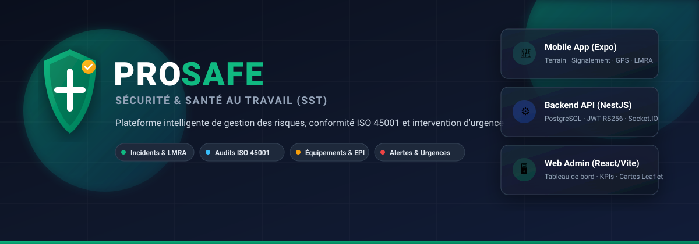

<div align="center">



# PROSAFE
### Integrated Occupational Health & Safety (OHS / SST) Enterprise Platform

[](README_fr.md)
[](https://www.typescriptlang.org/)
[](https://nestjs.com/)
[](https://react.dev/)
[](https://expo.dev/)
[](https://www.postgresql.org/)
[](https://socket.io/)
[](https://www.iso.org/standard/63787.html)
[](LICENSE)

<p align="center">
  <b>A comprehensive, cross-platform ecosystem designed to digitize risk prevention, accelerate field incident reporting, automate regulatory compliance, and protect workforce health and safety across organizations.</b>
</p>

[Key Features](#-key-features) •
[Tech Stack](#-tech-stack) •
[Architecture](#-system-architecture) •
[Quick Start](#-quick-start) •
[Roles & Access](#-roles-and-permissions) •
[Documentation](#-documentation)

---

</div>

## 📌 About PROSAFE

In industrial, construction, logistics, and service environments, managing **Occupational Health and Safety (OHS / SST)** poses critical challenges: slow reporting chains, under-reporting of near-misses, manual tracking of PPE inspections and mandatory training, and high friction during regulatory audits.

**PROSAFE** addresses these operational hurdles by connecting frontline personnel with safety managers in real-time through three integrated applications:
1. **Field Mobile App (Expo / React Native)**: Instant incident reporting with photo/video attachments, GPS tagging, Last-Minute Risk Analysis (LMRA), push emergency broadcasts, and PPE inventory access.
2. **Web Management Console (React / Vite)**: Interactive Leaflet geospatial incident maps, 5×5 risk matrix, ISO 45001 compliance audits, live KPI analytics, and corrective action workflows.
3. **Secure Backend Core (NestJS / PostgreSQL)**: Enterprise-grade REST API, bidirectional WebSockets, RS256 asymmetric JWT authentication, automated daily cron jobs, and push/email alert routing.

---

## 🛠️ Tech Stack

PROSAFE is built as a high-performance monorepo managed with **pnpm workspaces** and **Turborepo**:

| Layer | Technologies | Responsibilities |
|---|---|---|
| **Backend API** | **NestJS 10**, **TypeORM 0.3**, **PostgreSQL 16** | Scalable REST API, relational data modeling, migrations, ORM |
| **Security & Auth** | **JWT RS256**, **Bcrypt**, **Helmet**, **Passport** | Asymmetric key encryption, bcrypt hashing, XSS/CORS hardening |
| **Realtime Engine** | **Socket.IO 4.8** | Low-latency WebSockets for notifications, live alerts, and instant messaging |
| **Web Back-Office** | **React 18**, **Vite**, **Tailwind CSS**, **shadcn/ui** | Responsive admin dashboard, high-contrast accessibility (WCAG), data tables |
| **Data Visualization**| **Recharts**, **React Leaflet**, **Lucide Icons** | Statistical trend charts, incident frequency analysis, geospatial maps |
| **Mobile App** | **React Native 0.76**, **Expo SDK 52**, **Expo Router 4** | Cross-platform native application (iOS, Android, Web PWA) |
| **Device Integration**| **Expo Location**, **Image Picker**, **Secure Store**, **Notifications** | GPS coordinates capture, media uploads with magic-byte verification, push tokens |
| **Reporting & Exports**| **pdfkit**, **exceljs** | Automated PDF generation for OHS committees and Excel spreadsheets for audits |
| **Internationalization**| **i18next** | Complete trilingual support: French (default), English, and Arabic (RTL) |

---

## 🚀 Key Features

### 🚨 1. Incident Declaration & Workflow
- **Assisted Reporting**: Multi-file media capture (up to 5 photos/videos with magic-byte validation), automatic GPS coordinates, and timestamping.
- **Full Lifecycle**: Complete state machine (*Reported → Under Review → In Progress → Closed* or *Rejected*).
- **Severity Scoring**: Dynamic evaluation matrix (Severity × Probability) triggering automated corrective action assignments.
- **Audit Trail**: Immutable status history log documenting every review step, note, and closure justification.

### 🛡️ 2. Personal Protective Equipment (PPE) & Inventory
- **Asset Catalog**: Real-time tracking of individual and collective safety equipment.
- **Inspection & Expiry Tracking**: Maintenance scheduling, stock depletion alerts, and automated notifications for expiring gear.

### 🎓 3. Safety Training & Certifications
- **Worker Safety Passport**: Centralized register of certifications (Forklift/CACES, First Aid, Working at Heights, Electrical Safety).
- **Automated Renewals**: Proactive expiry warnings (30 days, 7 days, 1 day prior to expiration).
- **Skills Matrix**: Instant visibility into workforce qualification gaps with automated session planning.

### 📊 4. Risk Assessment & LMRA
- **5×5 Risk Matrix**: Visual workplace risk catalog mapped by department, probability, and consequence severity.
- **Preventive Action Plans**: Direct task assignment to owners with deadlines and overdue tracking.
- **LMRA (Last Minute Risk Analysis)**: Quick mobile safety checklist completed on-site prior to executing high-risk operations.

### 📋 5. Audits & ISO 45001:2018 Compliance
- **Standardized Checklists**: Built-in inspection forms aligned with ISO 45001:2018 requirements.
- **Compliance Scoring**: Real-time audit scoring by facility, department, or operational unit.
- **Document Safe**: Secure digital storage for safety protocols, Safety Data Sheets (SDS/FDS), and inspection certificates.

### 📢 6. Emergency Alerts & Evacuation Drills
- **Broadcast System**: High-priority push notifications and siren alerts broadcast to all active mobile devices on-site.
- **Action Scenarios**: Standard operating procedures (SOPs) for fire, chemical spills, medical emergencies, or structural hazards.
- **Evacuation Drills**: Scheduling, headcount verification, timer tracking, and post-drill reporting.

### 📈 7. Analytics & Executive KPIs
- **Safety Metrics**: Real-time Lost Time Injury Frequency Rate (LTIFR), severity rate, incident distribution heatmaps.
- **Trend Forecasting & Spike Detection**: Automated detection of anomalous incident clusters.
- **One-Click Reporting**: Export audit-ready PDF reports and detailed Excel workbooks for safety committees.

### 💬 8. Communication & Inclusivity
- **Direct Messaging**: Private, authenticated communication channels between workers and OHS managers.
- **Multilingual Support**: Fully localized in English, French, and Arabic with native Right-to-Left (RTL) layout.
- **Accessibility**: High-contrast mode, accessible color schemes, and dynamic font scaling.

---

## 🏛️ System Architecture

```
                 ┌─────────────────────────┐        ┌────────────────────────┐
  Field Workers  │    Mobile App (Expo)    │──┐     │ Web Admin (Vite/React) │ ◄── OHS Managers
  (On-Site)      │   iOS · Android · Web   │  │     │ Dashboard & GIS Maps   │     & Administrators
                 └─────────────────────────┘  │     └───────────┬────────────┘
                                              │ HTTPS + JWT     │
                                              ▼                 ▼
                                   ┌──────────────────────────────────┐
                                   │     Backend API (NestJS 10)      │── Swagger Docs (/api/docs)
                                   │     Socket.IO (/ws) Realtime     │
                                   │     Automated Cron Scheduler     │
                                   └───────┬────────────┬─────────────┘
                                           │            │
                                PostgreSQL 16 ◄┘        ▼ Local Disk Storage (Uploads)
                                           Expo Push · SMTP Mail Server
```

---

## 👥 Roles and Permissions

| Role | Access Level |
|---|---|
| 👑 `admin` | Full system control: governance, user lifecycle (approve, block, reassign roles, delete), and system settings. |
| 🛡️ `sst_manager` | OHS operations: incidents, risk matrix, compliance audits, PPE equipment, trainings, alerts, and analytics. |
| 👷 `employee` | Field execution: report incidents, submit LMRAs, view assigned equipment/trainings, access emergency procedures. |
| ⏳ `pending` | Newly registered accounts awaiting administrator approval before accessing platform features. |

> The first user registered during initial system setup is automatically granted the `admin` role.

---

## ⏰ Automated Cron Scheduler

The NestJS backend runs daily automated compliance and monitoring jobs (*Africa/Algiers timezone*):

- **06:30** : Incident spike detection → generates proactive manager alerts upon unusual activity.
- **07:00** : Low/depleted PPE stock alerts, maintenance inspection deadlines, training reminders (D-7, D-1), and expiring certifications.
- **07:15** : Upcoming security audit reminders.
- **07:20** : Regulatory compliance documents expiring within 30 days.
- **07:30** : Escalation reminders for overdue corrective actions.
- **07:45** : Escalation reminders for overdue risk action plans.

---

## ⚡ Quick Start

### Prerequisites
- **Node.js** >= 18.0.0
- **pnpm** >= 9.0.0
- **Docker** & **Docker Compose** (for PostgreSQL)

### 1. Clone & Install
```bash
git clone https://github.com/Abdelkouddous/prosafe.git
cd prosafe
pnpm install
```

### 2. Configure Database & Environment
```bash
cd apps/backend
docker compose up -d postgres
cp .env.example .env
# Populate RS256 JWT keys and database parameters in .env
cd ../..
```

### 3. Launch Development Servers
```bash
# Terminal 1: Backend API (port 3000)
pnpm --filter backend start:dev

# Terminal 2: Web Management Console (port 5173)
pnpm --filter admin dev

# Terminal 3: Expo Mobile App
pnpm --filter mobile start
```

- **Interactive API Swagger Docs**: [http://localhost:3000/api/docs](http://localhost:3000/api/docs)
- **Web Administration Portal**: [http://localhost:5173](http://localhost:5173)

---

## 📂 Repository Structure

```
prosafe/
├── apps/
│   ├── backend/        # NestJS 10 REST API, TypeORM, Socket.IO, Auth & Cron
│   ├── admin/          # React/Vite Admin Console, Tailwind, Recharts, Leaflet
│   └── mobile/         # Expo SDK 52 / React Native Cross-Platform App
├── assets/             # Brand identity, banners, and project media
├── docs/               # Technical specifications, API contracts & user guides
│   ├── SPEC.md         # Requirements tracking matrix & project checklist
│   ├── API_CONTRACT.md # Formal endpoint contract shared across client apps
│   ├── TECHNICAL.md    # Architecture deep-dive, security, and deployment guide
│   ├── USER_GUIDE.md   # Detailed user guide (French)
│   └── DEPLOY_CHECKLIST.md # Step-by-step production rollout checklist
├── README_fr.md        # Documentation en Français (Archive)
├── pnpm-workspace.yaml # Monorepo workspace configuration
└── README.md           # Main project documentation (English)
```

---

## 📚 Documentation

Detailed technical references are maintained in the [`docs/`](docs/) directory:

- 📖 [User Guide (French)](docs/USER_GUIDE.md): Step-by-step instructions for safety managers and field workers.
- 📐 [Shared API Contract](docs/API_CONTRACT.md): Comprehensive reference for all REST endpoints and WebSocket events.
- 🏗️ [Technical Architecture](docs/TECHNICAL.md): Detailed database schemas, security posture, and test suites.
- 🚀 [Production Deployment Checklist](docs/DEPLOY_CHECKLIST.md): Operational guide for production releases.

---

## 📄 License

This project is licensed under the [MIT License](LICENSE).
